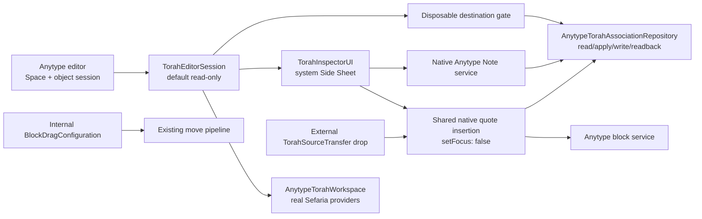

# ADR addendum: bounded iPad Torah Inspector trial

Date: 2026-10-20

Status: **IMPLEMENTED ON ISOLATED BRANCH; CI AND USER DEVICE VALIDATION PENDING**

## Decision

Proceed with the complete read-only Kit experience and an explicitly opted-in,
single-active-writer persistence trial on a dedicated branch. This addendum
does not supersede the T2 concurrency ADR and does not convert the failed
T2-L AccountSelect probe into a pass.

The reader is always available. Every document/block association mutation,
quote insertion and Note link/unlink remains disabled until the user confirms
all three conditions in the current document session:

1. the Space is newly created and disposable;
2. the document is new and empty;
3. the literal confirmation `DISPOSABLE` is entered.

The opt-in is in-memory and resets with the document session. It is not a
promise that the backend can merge concurrent scalar writers. Only one active
writing device is supported.

## Architecture

`PinkhaKit` continues to depend on `TorahInspectorCore` only. The Anytype app
target separately links `TorahInspectorUI` at the same immutable Kit commit.
The Kit view retains its own `NavigationStack`; the host adds none.

## Safety and failure semantics

- A present non-string `pinkha.torahAssociations` value throws
  `malformedCanonicalData`; absence alone is treated as an empty payload.
- Future/corrupt JSON, wrong Space/object/block, deletion/archive, permissions,
  conflict and uncertain acknowledgment retain the existing fail-closed paths.
- `saved` is shown only after the repository returns from native readback.
- If the quote block succeeds but its provenance association does not, the UI
  reports an uncertain partial insertion and never calls it fully sourced.
- External Torah drops are copy operations and claim a transfer identity once;
  internal editor block drags stay on the original move route.
- Note unlink deletes only the association. The actual Note object is preserved.
- No mnemonic, account secret, production sandbox or middleware data directory
  is requested, logged or copied.

## Deliberate limitations

- The automatic agent environment has not observed a physical iPad. Relaunch,
  offline persistence, actual Side-Sheet-to-editor drag, rotation, Stage
  Manager/compact window, iPhone fallback, Undo/Redo and two windows are
  `USER TEST PENDING`.
- No verified edit-stable native selected-text anchor was found. The trial does
  not expose a misleading UTF-16-only durable text-span link.
- Native quote text uses Anytype's visible quote style and remains copyable, but
  strict read-only editing protection is not claimed.
- Kit's “open in new tab” callback is intentionally not exposed because the
  host has no genuine separate Torah tab/window route. In-Kit relationship
  navigation remains real.
- Full T2 multi-device merge, global Knowledge/reverse index, U12/U13 and
  production rollout are outside this addendum.

## Separate application identity

The Xcode 27 workflow builds the normal unsigned device product, removes its
embedded extensions from the experimental package, and changes the packaged
app's identifier to `com.gloiiire.anytype.torahtrial` and display name to
`Anytype Torah Trial`. This avoids replacing the normal app and produces a
separate sandbox. It does **not** share the normal app's logged-in account or
sandbox; the user must follow normal login in the trial app. No signing assets
are created. The unsigned IPA still requires an external signing/sideloading
workflow compatible with that identifier.

## Modified-file inventory

Kit branch:

- `Sources/TorahInspectorUI/TorahInspectorSheetPresenter.swift`
- `Sources/TorahInspectorUI/TorahStrings.swift`
- `Sources/TorahInspectorUI/Resources/{en,he}.lproj/Localizable.strings`
- `Tests/TorahInspectorUITests/TorahInspectorHostActionsTests.swift`
- `Demo/project.yml`, `Demo/App/TorahInspectorSheetDemoApp.swift`,
  `Demo/UITests/TorahInspectorSheetDemoUITests.swift`
- `.github/workflows/ios27-side-sheet.yml`

Anytype branch:

- `Modules/PinkhaKit/Package.swift` and
  `TorahInspectorRepositoryFactory.swift`
- `Anytype.xcodeproj/project.pbxproj`
- `Anytype/Sources/Pinkha/Torah/Storage/TorahAssociationNativeStore.swift`
- `Anytype/Sources/Pinkha/Torah/UI/*.swift`
- editor coordinator, assembly, view model, block option and drag/drop hooks
  listed in `UPSTREAM_HOOKS.md`
- `AnyTypeTests/Pinkha/TorahAssociationNativeRepositoryTests.swift`
- `.github/workflows/torah-inspector-ipados27.yml`
- the six evidence/scope documents updated or added by this change.

## Evidence boundary

- Old simulator recovery: run `39306273085` — **FAIL**, unchanged.
- Kit Xcode 27 lane: current run `39337576270` — pending at authoring time;
  prior run `39333954262` failed only its UI identifier observation after
  package compilation/tests passed.
- Anytype Xcode 27/IPA lane: run `39335838450` — pending at authoring time.
- Physical iPad: **USER TEST PENDING**.
